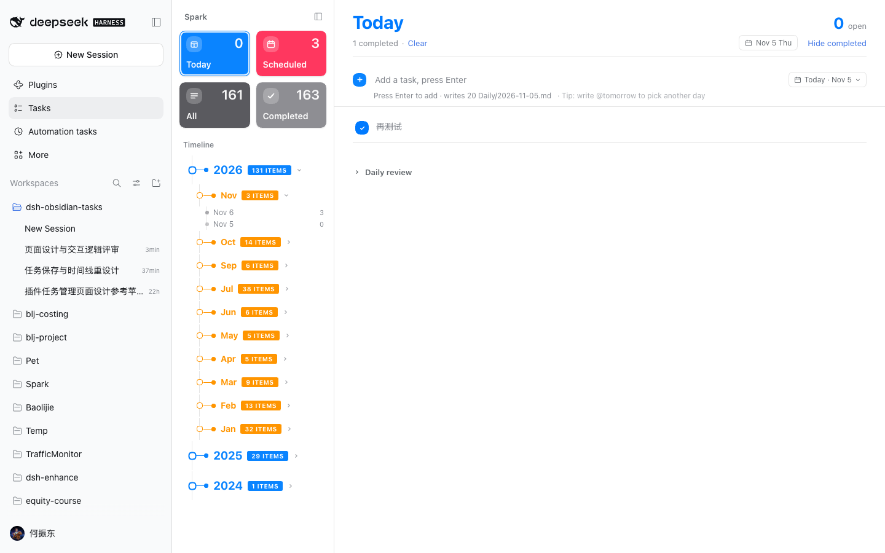
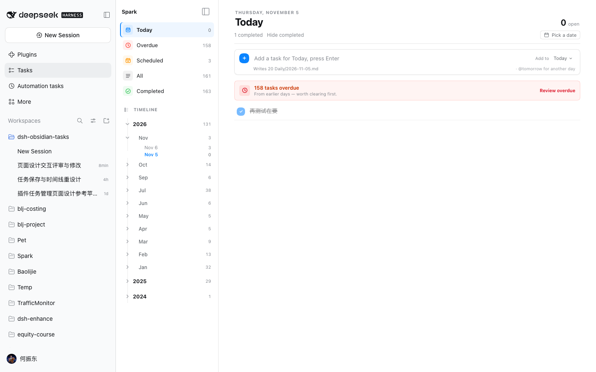
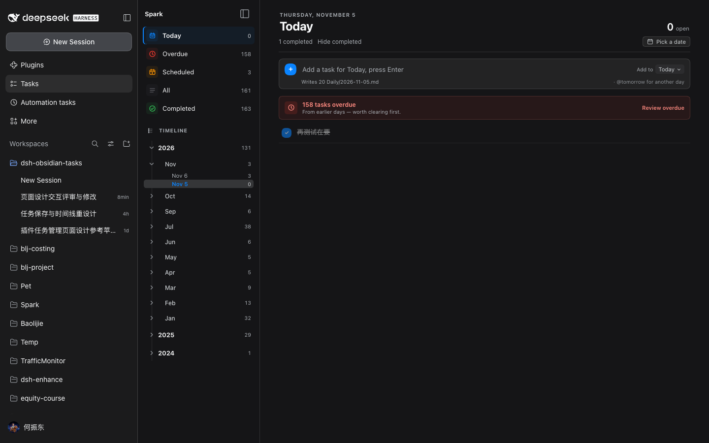

# 任务看板设计与交互评审（v1）

- 评审对象：`dsh-obsidian-tasks` v0.11.0 任务看板页面（`src/client/BoardPage.tsx`、`styles.ts`、`Calendar.tsx`）
- 评审方式：源码走查 + 真实 `dsh web` 1440×900 运行截图 + 1100/900/760/620 宽度检查 + 亮色/暗色检查
- 评审结论：**结构可用，但信息架构和交互模型需要重做一版**。主要问题不是单个控件，而是「导航、日期、计数」三套状态各自为政。

## 一、设计逻辑问题

### P0：页面没有把用户带回「今天要做什么」

原版 Today 只统计当天 note 的未完成任务，历史未完成既不在 Today，也不在 Scheduled；截图里 Today 0、Scheduled 3、All 161，意味着约 158 条逾期任务被藏在 All/时间线里。对每日任务管理来说，这会让「今天没事」成为最危险的误判。

**改法**：新增一级「逾期」视图，计数按整库统计；Today 顶部常驻逾期提示卡，显示数量并可一键进入逾期视图（按天分组、最近优先）。

### P0：左侧导航同时承担了三种互相竞争的任务

原版左栏是四张高饱和 Smart Cards + 年/月/日树状时间线 + 标签统计，三套导航都在争夺注意力；时间线每一个节点又有圆环、横线、实心圆点、大号数字和实心大写色块，视觉重量远超「今天要做什么」的内容。

**改法**：
- 四张彩色卡片改为五行安静的智能视图（彩色小图标 + 文案 + 右对齐计数），让颜色只做识别、不做大面积铺色。
- 时间线降级为「可折叠浏览区」：一个节点标记 + 标签 + 数字，去掉圆环/分支/大写实心条，保留层级与选中态。
- 标签统计移到时间线底部，按全库任务聚合。

### P1：主内容列缺少最大宽度，长行破坏扫读

原版在 1440px 下任务行横跨约 1000px，任务文字、标签、日期操作之间距离过远。

**改法**：内容列 `max-width: 900px` 居中，标题、添加卡、任务行共享同一条内容轴。

### P1：高饱和标题与颜色语义混乱

原版标题根据视图变成蓝/红/橙/紫/靛，完成勾选也使用当前视图的 accent；同一个「完成」在不同视图下会变色。标题 30px 高饱和色成为第一视觉焦点，任务本身反而退到后面。

**改法**：标题回到中性色，日期用上方 eyebrow 表达；颜色只用于视图图标、逾期警告和统一的完成状态（固定蓝色）。

### P1：缺少响应式策略

原版固定 264px 侧栏，没有媒体/容器查询；窗口变窄时右栏被压缩到 100–200px，标题、计数、追加提示被拆成竖排。

**改法**：用 `ResizeObserver` 测量页面自身宽度，低于 780px 自动折叠为 56px 图标轨；标题、添加条、hint 在 760/520 两级收窄；外层 DSH 侧栏收窄时也不会再破版。

### P2：组件与焦点层级

- 原版智能卡片 74px 高、任务行 14px，信息权重倒置；已改为 24px 图标行 + 44px 任务行。
- 原版两个日期控件（头部 date pill、添加栏 date chip）同款同色同图标；新版添加栏改成「Add to + 目标日 chip」，头部改成「Pick a date」跳转控件，形状与文案区分。
- 原版空态只有一行「没有任务」；新版区分空态 / 加载态 / 标签无匹配三种文案，并给出「添加一条」动作。

## 二、交互逻辑问题

### P0：全局 `busy` 锁让整块看板像卡住

原版 `run()` 用一个全局 boolean 控制所有 checkbox、add input、按钮；勾一条任务，全板的勾选框和输入框一起变灰。连续勾选或添加会被串行化在 UI 上，慢盘时尤其明显。

**改法**：
- 勾选改为逐条 pending key，只禁用当前任务的 checkbox；
- 所有写操作进入同一个 Promise 队列，避免 `setSnapshot` 的后返回旧响应覆盖新状态；
- 添加输入在勾选期间保持可用；成功/失败提示改为右下角浮层，不再顶动列表。

### P0：Today 漏掉逾期任务（同设计 P0）

**改法**：逾期一级视图 + Today 顶部提示卡，见上。

### P1：`Clear` 文案与行为不一致

原版「清除」实际只是 `setShowCompleted(false)`，没有删除任何东西；旁边还有一个「隐藏已完成」，两个控件做同一件事；在 Completed 视图点「清除」会把整个已完成列表清空但计数还在。

**改法**：删除 `Clear`，只保留「隐藏已完成 / 显示已完成」；Completed 视图强制显示已完成，不应用隐藏状态。

### P1：计数口径不一致

原版标签统计只取 anchor ±4 天窗口且包含已完成，Smart Cards 取全库且只算未完成，时间线色块写「ITEMS」但实际是未完成数。

**改法**：
- 标签统计由服务端 `timelineFor` 全库聚合（新增 `tags` 字段），与时间线同一次遍历、同一刷新时机；
- 时间线只显示数字，不再写「items」；
- 全部/已完成拆分口径：All = 全部未完成，Completed = 全部已完成；Today/Overdue/Scheduled 均只显示未完成（Today 中已完成单独按「completed」计数展示）。

### P1：月/年视图的日期控件指向错误日期

原版 `shownDate` 在非 day 视图取 anchor，但月/年 pill 显示的是 view 的月份；点开日历却跳到与列表无关的旧 anchor。

**改法**：`calendarValue` 由当前 scope 派生（月视图 = 当月 1 日，年视图 = 1 月 1 日，智能视图 = 今天）；非日视图 pill 文案统一为「选择日期 / Pick a date」。

### P1：切换 wide view 时旧数据残留、无加载态

原版 `rangeGroups` 在请求成功前保持旧周期数据，标题已经变成新周期但列表还是旧的。

**改法**：切换时先清空 `rangeGroups` 并置 `rangeLoading`，加载期间显示 loading；请求返回后按当前 view 渲染。

### P1：时间线与右侧视图不同步

原版点年/月只 `setView`，不更新 anchor；从日历跳转也不会展开对应年/月。

**改法**：年/月点击同步 `anchor`；日历选日调用 `revealDate` 展开对应年/月；时间线 active 节点自动 `scrollIntoView({ block:'nearest' })`。

### P2：破坏性操作与撤销

原版删除只在编辑态显示 24px 的 `×`，点击立即删除 Markdown 行；顺延选回原日期会在同一文件先删后追加，生成两条任务。

**改法**：顺延增加同日期 no-op；`board.ts` 的 `moveTask` 也增加同日保护。删除仍保留在编辑态（有写前备份），后续可再补 5 秒撤销 toast 与二次确认（见「剩余风险」）。

### P2：`today` 跨午夜不更新

原版 `useState(todayIso)` 只在挂载时计算一次。

**改法**：60 秒定时 + `visibilitychange` + `focus` 重算；若当前是 Today 视图，同步 anchor/addDate。

## 三、可保留的部分

- 与 Host 路由共用 `src/board.ts` 的写入逻辑、写前备份、路径护栏都保留。
- 自制月历（圆形日期格、今天/明天/后天快捷、点击外部收起）保留，视觉只随新内容列微调。
- `@今天/@明天/@后天` 排期解析保留。
- 行内编辑、圆形勾选、按 `##` 标题分组保留。

## 四、修改清单（v0.12.0 / v0.12.1）

| 文件 | 修改 |
|---|---|
| `src/client/BoardPage.tsx` | 新信息架构（五智能视图 / 可折叠时间线 / 逾期卡）、逐条 pending、写队列、日期 scope、跨午夜刷新、空/加载态 |
| `src/client/styles.ts` | 新视觉系统、900px 内容列、56px 自动图标轨、760/520 响应式、hover 才出现的顺延按钮、浮层 toast |
| `src/client/locales.ts` | 新增逾期/空态/日期等文案，移除 `Clear` 相关旧 key |
| `src/client/api.ts` | `TimelineSnapshot.tags` 类型 |
| `src/board.ts` | `timelineFor` 全库标签聚合、`moveTask` 同日保护 |
| `src/routes.ts` | `/timeline` 返回 `tags` |
| `tests/board.test.ts` | 标签聚合与空标签断言 |
| `README.md` | 更新页面说明 |
| `package.json` | 0.11.0 → 0.12.1 |

### v0.12.2 第二轮反馈补丁

- 删除时间线区整体的折叠状态与「TIMELINE」前 chevron，改为**时间线小图标 + TIMELINE 标签**，时间线常驻展开。
- 年/月 disclosure 按钮从 16×16 放大到 22×22，箭头 SVG 从 10px 放大到 14px。
- 竖向引导线改为与 22px 箭头按钮中心对齐（实测 chevron 中心与 border-left 均为 x=308）。

### v0.12.3 第三轮反馈修复

- 移除 Daily review：任务看板不再提供「追加复盘」输入区，避免与 Obsidian 本体和 `ob_note_append` 工具重复；页面聚焦任务本身。
- 时间线改为**固定单列**：header 图标、年 / 月 / 日 disclosure 图标统一左对齐到导航图标列；所有层级文字从同一左边界开始。
- 连续竖向引导线落在图标列中心，年 / 月箭头从 16×16 放大到 22×22、SVG 从 10px 放大到 14px。
- 侧栏折叠按钮从 24px 放大到 32px、glyph 从 16px 放大到 20px。

### v0.12.4 回归修正

- 撤销 v0.12.3 的「全部文字同一左边界」：该版把年 / 月 / 日压成平铺列表，层级丢失；本版恢复文字缩进（月 14px / 日 28px），同时保留所有 disclosure 图标的固定 22px 列对齐。
- 竖向引导线只覆盖时间线树本身，不再延伸到空白区域。

### v0.12.1 第二轮反馈修复

- **时间线**：去掉圆环 / 分支 / 实心圆点等叠层装饰，改为 chevron + 名称 + 右对齐计数的树形行，层级靠缩进和连续引导线；解决「时间线全乱」。
- **更新任务无法保存**：根因是 `text === target.text` 永远成立（`target` 就是当前编辑对象），任何修改都会被当作「未变化」直接返回；编辑状态新增 `original`，改为与原文比较，改一个字也会保存。
- **顺延日历**：任务行按钮放大到 26px / 14px 图标；弹层改为向左展开，解决「日历藏到右边」。
- **背景色**：侧栏由 `bg-layer-2` 改为 `bg-base`，与主内容区统一，靠 1px border 区分；解决暗色主题下侧栏大片色块不协调。

## 五、修改前 / 后

修改前（真实 `dsh web`，2026-11-05，Spark 库）：

修改后（同一 `dsh web`，Today 视图；Spark 真实库，仅只读展示）：

## 六、验证

- `pnpm test`：64 项通过（含 `timelineFor` 标签聚合）。
- `pnpm typecheck`：Node / Client 两端通过。
- `pnpm build`：`lib/index.js` 与 `lib/client.js` 产物就位。
- 真实 `dsh web`（`--port 45999`）：Today / Overdue / Completed / Month / Tag filter / 添加 / 勾选 / 日历弹层 / 760px 自动图标轨均实际点过并截图；测试数据写入临时 `~/tmp/ob-review-vault`，验证后已还原配置。
- `node script/e2e-board.mjs`：全部通过（看板 Host 路由、编辑/删除、追加快照、鉴权）。

## 七、剩余风险 / 待验证

1. 删除任务的撤销/二次确认尚未做；当前仍为编辑态点击即删（有写前备份，可手工恢复）。
2. 日历键盘操作仍是「全部格都可 Tab」，尚未实现 roving tabindex 与方向键；已加 `focus-visible` 样式，完整键盘导航留待下一版。
3. 极窄（<520px）时 DSH 自身也会收成图标轨，页面可用但密度较高；已在 760/520 两级做过截图验证，尚未在真实触屏设备上验证。
4. `script/preview-addbar.mjs` 仍是旧版手工预览页，未跟随新结构重写；本轮视觉验证以真实 `dsh web` 为准。

*评审与验证日期：2026-11-05*
